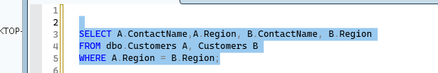
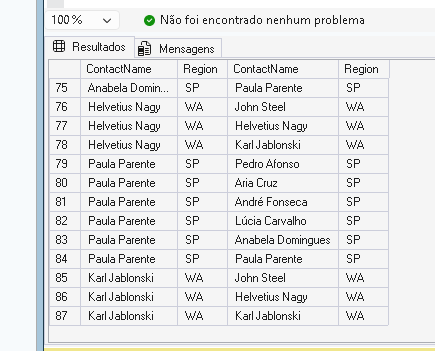
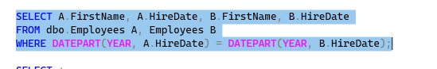
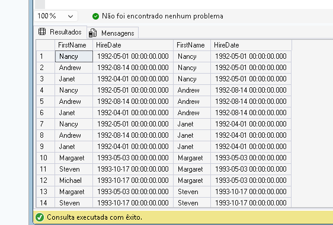

# SELF JOIN em SQL

Um **SELF JOIN** (autojunção) é uma técnica na linguagem SQL em que uma tabela é associada a **ela mesma**. 

Em termos práticos, não existe uma cláusula ou palavra-chave chamada `SELF JOIN` no SQL. O que ocorre é o uso de junções convencionais (como `INNER JOIN`, `LEFT JOIN` ou a junção implícita na cláusula `FROM`), aplicando **aliases (apelidos)** diferentes para a mesma tabela como se estivéssemos trabalhando com duas tabelas distintas.

---

## Para que serve o SELF JOIN?

O SELF JOIN é amplamente utilizado quando precisamos relacionar e comparar linhas pertencentes à mesma tabela. Alguns cenários comuns incluem:

- **Comparar registros com base em atributos em comum:** Ex.: encontrar clientes que pertencem à mesma região, funcionários admitidos no mesmo ano ou produtos com o mesmo preço.
- **Estruturas hierárquicas:** Identificar relações de subordinação (por exemplo, em uma tabela de funcionários onde uma coluna guarda o ID do gerente/supervisor, que também é um funcionário na mesma tabela).
- **Identificar duplicatas ou inconsistências:** Comparar registros semelhantes para auditoria ou higienização de dados.

---

## Sintaxe

Como estamos referenciando a mesma tabela mais de uma vez na mesma consulta, **o uso de aliases (apelidos) é obrigatório** para evitar ambiguidade.

### Sintaxe Clássica (Implícita com `WHERE`)
```sql
SELECT A.coluna1, B.coluna1, ...
FROM NomeTabela A, NomeTabela B
WHERE A.coluna_criterio = B.coluna_criterio;
```

### Sintaxe ANSI SQL (Explícita com `JOIN ... ON`)
```sql
SELECT A.coluna1, B.coluna1, ...
FROM NomeTabela A
JOIN NomeTabela B 
    ON A.coluna_criterio = B.coluna_criterio;
```

---

## Exemplos Práticos

Abaixo estão dois exemplos demonstrando a aplicação do SELF JOIN no SQL Server.

### Exemplo 1: Comparando Clientes da Mesma Região

Neste primeiro exemplo, realizamos um SELF JOIN na tabela `dbo.Customers` para listar clientes que pertencem à mesma região geográfica (`Region`).

#### Consulta SQL:
```sql
SELECT A.ContactName, A.Region, B.ContactName, B.Region
FROM dbo.Customers A, Customers B
WHERE A.Region = B.Region;
```



#### Resultado:


> **Observação:** Repare que clientes com a mesma região (como `SP` ou `WA`) são combinados entre si, inclusive com o próprio registro.

---

### Exemplo 2: Comparando Funcionários Contratados no Mesmo Ano

No segundo exemplo, utilizamos a função `DATEPART(YEAR, ...)` para comparar datas na tabela `dbo.Employees`, retornando funcionários que foram contratados no mesmo ano.

#### Consulta SQL:
```sql
SELECT A.FirstName, A.HireDate, B.FirstName, B.HireDate
FROM dbo.Employees A, Employees B
WHERE DATEPART(YEAR, A.HireDate) = DATEPART(YEAR, B.HireDate);
```



#### Resultado:


> **Observação:** O resultado lista os pares de colaboradores admitidos em 1992 e 1993, permitindo cruzamentos diretos dentro da própria tabela de funcionários.

---

## Dica Importante: Evitando Auto-comparações e Duplicatas Invertidas

Ao executar `WHERE A.Coluna = B.Coluna`, cada registro será associado a si mesmo e também gerará combinações espelhadas (ex: `A com B` e `B com A`).

Para refinar e exibir apenas pares de registros distintos sem repetições:

1. **Evitar comparar o registro com ele mesmo:**
   ```sql
   WHERE A.Region = B.Region
     AND A.CustomerID <> B.CustomerID;
   ```

2. **Evitar pares duplicados invertidos (A, B) e (B, A):**
   ```sql
   WHERE A.Region = B.Region
     AND A.CustomerID < B.CustomerID;
   ```
